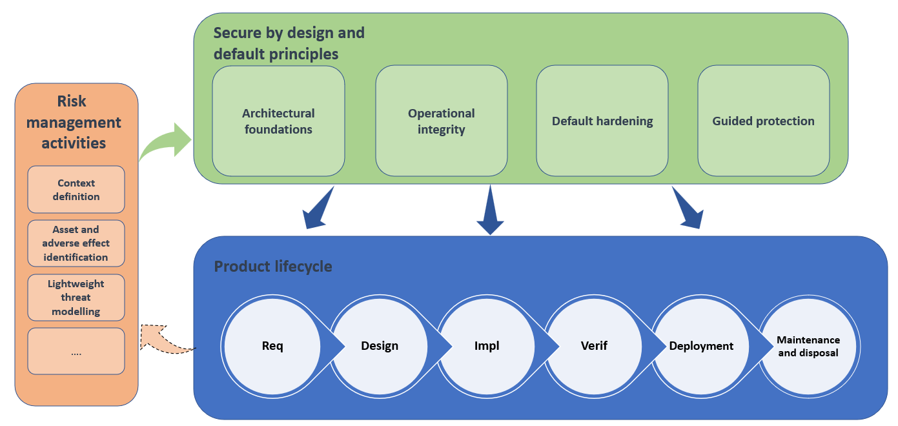

# ENISA Secure by Design and Default Playbooks 日本語訳

> 訳注：本稿は ENISA の「Secure by Design and Default Playbook」（[https://github.com/enisaeu/enisa-sbd-playbook](https://github.com/enisaeu/enisa-sbd-playbook)）を原文として翻訳したものです。原著は CC-BY 4.0 で提供されており、派生物としての日本語訳でも原著の明示とライセンスの保持が必要です。本訳は Lex0xF0C（GitHub: [https://github.com/Lex0xF0C](https://github.com/Lex0xF0C)）によって作成されました。

実務的なコレクションとして、SME 向けに用意された 22 の Secure by Design / Secure by Default のプレイブックです。これは *[ENISA Secure by Design and Default Playbook: A Practical Guide to Secure by Design and Default](https://www.enisa.europa.eu/publications/enisa-secure-by-design-and-default-playbook)* に基づいています。

## このリポジトリについて

Secure by Design は、製品セキュリティを開発後に後付けで強化するのではなく、開発の初期段階から組み込むという基本的な考え方です。Secure by Default は、製品が可能な限り安全な初期設定で出荷されるようにする考え方です。

このリポジトリは、抽象的なセキュリティ原則と、SME が実際に取り組める実装方法との間のギャップを埋めることを目的としたプレイブック集を提供します。構造化され、実務にすぐ使える形式で整理されており、実装の難易度や制約に応じて適用できます。

このガイダンスは、網羅的・規定的な実装フレームワークではなく、実務的な出発点として提供されています。適用の方法は、製品の想定利用方法、コンテキスト、技術的制約、脅威モデルに応じて調整すべきものです。

## プレイブックの構成

各プレイブックには以下が含まれます。

- 原則
- 目的
- チェックリスト
- 最低限の証跡
- リリースゲート

## プレイブック一覧

### Secure by Design

Secure by Design は、製品の開発中にセキュリティ対策を組み込み、後から追加することを避ける考え方です。

- **Architectural Foundations（設計基盤）** — 製品が本質的に侵害や悪用を受けにくくする構造的な設計上の選択。
- **Operational Integrity（運用整合性）** — 開発、展開、運用、廃止に至るまで、製品セキュリティを維持するための人と手順の実践。

| 設計基盤 | 運用整合性 |
|---|---|
| • [Trust boundaries and threat modelling](playbooks/01-trust-boundaries-and-threat-modelling.md) • [Least privilege](playbooks/02-least-privilege.md) • [Strong identity and authentication](playbooks/03-strong-identity-and-authentication.md) • [Secure architecture and design principles](playbooks/04-secure-architecture-and-design-principles.md) • [Secure defaults and configuration management](playbooks/05-secure-defaults-and-configuration-management.md) | • [Secure coding and verification practices](playbooks/09-secure-coding-and-verification-practices.md) • [Logging, monitoring and alerting](playbooks/10-logging-monitoring-and-alerting.md) • [Vulnerability management and remediation](playbooks/11-vulnerability-management-and-remediation.md) • [Security testing and validation](playbooks/12-security-testing-and-validation.md) • [Incident response and resilience](playbooks/13-incident-response-and-resilience.md) |

### Secure by Default

Secure by Default は、製品が合理的に可能な限り安全な設定で出荷されることを保証する考え方です。

- **Default Hardening（既定設定の強化）** — ソフトウェアの工場出荷時の状態を、初期設定としてできるだけ制約の厳しい状態にする。
- **Guided Protection（ガイド付き保護）** — ユーザーが安全な状態を維持できるように、必須の設定手順、オートメーション、明確なフィードバックを提供する。

| 既定設定の強化 | ガイド付き保護 |
|---|---|
| • [Minimisation of default services](playbooks/15-minimisation-of-default-services.md) • [Restrictive initial access](playbooks/16-restrictive-initial-access.md) • [Secure communication configuration](playbooks/17-secure-communication-configuration.md) • [Secure update and patch processes](playbooks/18-secure-update-and-patch-processes.md) • [Input validation and data handling](playbooks/19-input-validation-and-data-handling.md) | • [User awareness and training](playbooks/20-user-awareness-and-training.md) • [Secure configuration guidance and documentation](playbooks/21-secure-configuration-guidance-and-documentation.md) • [Access governance and auditing](playbooks/22-access-governance-and-auditing.md) • [Continuous improvement and review](playbooks/23-continuous-improvement-and-review.md) • [Product security reporting and disclosure](playbooks/24-product-security-reporting-and-disclosure.md) |

### プレイブックがどう連携するか

図 1 は、製品ライフサイクル、Secure by Design / Secure by Default の原則、およびリスク管理活動の関係を示しています。

リスク管理活動は、何を守るべきか、どの脅威が懸念されるか、許容される残存リスクのレベルなどを明確にし、セキュリティの文脈を確立します。

*図 1: 製品のライフサイクル全体における Secure by Design と Secure by Default.*

## 段階的な導入

プレイブックは、まず文脈と優先順位を確立し、その後に適切なエンジニアリングベースラインを設け、最後により広範な実装へ進む、という段階的な形で導入できます。ここでいう段階的導入は、重点的に対応すべきリスクと適用要件に対して優先度の高いチェック項目から着手し、対象範囲と証跡の強化を段階的に進めることを意味します。

| 段階 | 例示プレイブック | 重点 |
|---|---|---|
| **1. 文脈と優先順位を確立する** | • [Trust boundaries and threat modelling](playbooks/01-trust-boundaries-and-threat-modelling.md) | 製品の文脈、リスク管理、脅威モデリングを用いて、優先度と影響範囲を明確化する |
| **2. 基盤となるエンジニアリングベースラインを確立する** | • [Secure coding and verification practices](playbooks/09-secure-coding-and-verification-practices.md) • [Logging, monitoring and alerting](playbooks/10-logging-monitoring-and-alerting.md) | 品質と可観測性を含む基盤を定義し、セキュリティへの基準を整える |
| **3. 実装を広げて強化する** | • 残りの適用可能なプレイブック | 製品の文脈、意図する利用方法、リスク、および要件に応じて残りのプレイブックを実装・優先順位付けする |

製品によっては、基盤段階で他のプレイブックも実装が必要になることがあります。たとえば、可用性を重視する製品では、[Incident response and resilience](playbooks/13-incident-response-and-resilience.md) を早期に導入する必要があるかもしれません。

段階的な導入は、個々のプレイブック内でも適用可能です。組織は、優先度の高いリスクや適用される要件に対応するチェック項目から着手し、カバレッジと証跡を段階的に強化できます。

この順序は例示であり、後に扱うプレイブックが自動的に重要でないわけではありません。また、適用されるセキュリティ要件や規制要件は後回しにできないことがあります。

## 想定される利用者

このガイダンスは次の人々を対象としています。

- ソフトウェア開発者およびエンジニア
- 技術的なプロダクトマネージャー
- SME のセキュリティ責任者
- システムアーキテクト

特に、デジタル要素を含む製品を開発する SME 製造業者にとって重要です。

## 想定される成果

これらのプレイブックを適用することで、次のような成果が期待できます。

- 繰り返し発生しやすく、事前に防止可能な脆弱性の減少;
- 安全な既定設定と不要な露出の削減を伴う製品の提供;
- セキュリティリスクの早期発見と対応;
- 依存関係、ビルドプロセス、リリース、更新の可視性と保護の強化;
- 脆弱性の検出、修正、周知を迅速に行う能力の向上; および
- 製品ライフサイクル全体におけるサイバーセキュリティインシデントの発生可能性と影響の低減.

これらの成果は、より安全で回復力の高い製品を通じて利用者や運用者に利益をもたらします。製造者には一貫したセキュリティ判断がもたらされ、顧客やインテグレータにはより明確な保護と一般的な信頼性の向上がもたらされます。

